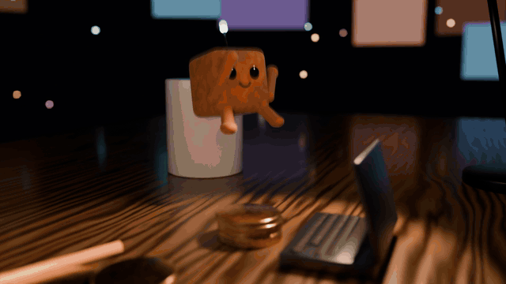

# video-director

**Primary model: Claude Opus 5.5 · For Claude Code**

**English** | [简体中文](README.zh-CN.md)

**video-director is built primarily for Claude Opus 5.5 in Claude Code.** It guides the model to create short videos as code (HTML, Canvas, SVG, Three.js, GSAP or Remotion), rendered frame by frame to MP4. It covers launch films, promos, explainers, data stories, kinetic type, character and illustrated shorts, loops and social reels.

The skill treats **Claude Opus 5.5** as the director and coding agent: plan the film in numbers, build it deterministically, then measure what it can't watch or hear. It holds principles with their reasons, a workflow with a gate at each phase, and two QA scripts. It deliberately ships no shot library to copy.

## Animation demo

### Hand-drawn city

[](assets/demo.mp4)

[Watch the original MP4 (30 seconds, 720 × 720, 60 fps)](assets/demo.mp4)

### 3D character animation

[](assets/character-demo.mp4)

[Watch the original MP4 with audio (16 seconds, 1920 × 1080, 24 fps)](assets/character-demo.mp4)

## What's inside

| Path | What it is |
|---|---|
| [`video-director/SKILL.md`](video-director/SKILL.md) | The stance, the per-film dials (clock, continuity, register, text policy), 13 principles, the build contract, the brief structure and the definition of done |
| [`video-director/references/`](video-director/references/) | Templates (treatment, timeline, facts, delivery report), craft numbers, sound, the QA catalogue and critic rubric |
| [`video-director/scripts/`](video-director/scripts/) | `check_timeline.py` validates the plan before any code; `qa_video.py` measures the render: hook text size and contrast, frame 0, flashes, cuts, freezes, loop seam, loudness, silences, contact sheets |
| [`video-director/evals/`](video-director/evals/) | Three test briefs with graders |
| [`METHODOLOGY.md`](METHODOLOGY.md) | The research the skill was distilled from: what drives quality across eight public repositories |

## Recommended model: Claude Opus 5.5

**Recommended setup: Claude Code with Claude Opus 5.5 selected.** Give Opus 5.5 a video brief; the skill guides it through planning, writing the animation code, rendering, checking the result and revising specific defects. Other capable coding agents can also follow the workflow, but **Claude Opus 5.5 is the primary intended model**.

This is an instruction-and-QA skill, not a bundled model or hosted video-generation service. Its output still depends on the available code execution and rendering tools.

## Install

In Claude Code, select **Claude Opus 5.5** and copy the skill folder into your personal skills (or into a project's `.claude/skills/`):

```bash
git clone https://github.com/win4r/video-director.git
```

```bash
cp -R video-director/video-director ~/.claude/skills/
```

In the Claude apps, zip the inner `video-director/` folder and upload it as a custom skill.

The scripts need `ffmpeg`/`ffprobe` and Python 3 with `numpy` and `Pillow`. Rendering HTML films needs Node with Playwright and Chromium (or use Remotion). `faster-whisper` is optional, for checking narration, and any text-to-speech works for voice.

## Use

With **Claude Opus 5.5** selected in Claude Code, ask for a video in plain words; the skill is designed to respond even to a one-liner:

- "Make a 15 second looping launch video for our CLI. Everything you need is in the README."
- "I need a ~30 second narrated explainer on how a bloom filter works, 16:9."
- "A 20-second Reel from subscribers.csv for our public account. Keep it honest."

It also reviews and fixes existing coded videos ("this feels slow", "the text is unreadable"). You can run the checks yourself:

```bash
python3 video-director/scripts/check_timeline.py timeline.json
```

```bash
python3 video-director/scripts/qa_video.py film.mp4 --out qa/ --beats timeline.json
```

## Eval results

Each round ran the three briefs once per configuration. Script checks graded the measurable assertions; blind graders that didn't know which run was which graded the rest and picked the film they'd post.

| Round | Compared | Assertions passed | Blind preference | Cost |
|---|---|---|---|---|
| 1 | Skill vs no skill | 28/28 vs 25/28 | 2–1 for the skill | about 2× the time and tokens |
| 2 | Current skill vs round-1 skill | 30/32 vs 26/32 | 3–0 for the current skill | about the same |

Round 1 showed the skill catching craft basics (a black first frame, text under the Reels caption, quiet audio). It also showed two gaps: a tagline held back until 11 s, and an explainer that never said "false positive". Round 2 added the rules that fixed them. The hook and any call to action are on screen by 3 s with the sound off, at measured size and contrast. The terms the audience searches for are said and shown. Labels never sit on numbers that are still counting. With one run per configuration, treat these as a direction, not a measurement. The guidance for character and illustrated films, revisions and live pages was added after round 2 and hasn't been evaluated yet. These results do not establish a controlled comparison of Claude Opus 5.5 against other models.

## License

[MIT](LICENSE)
